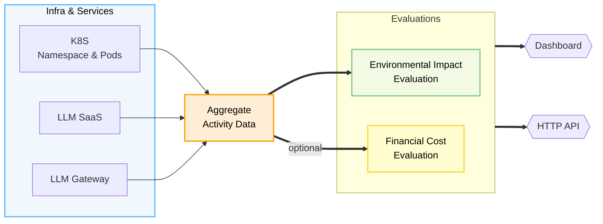
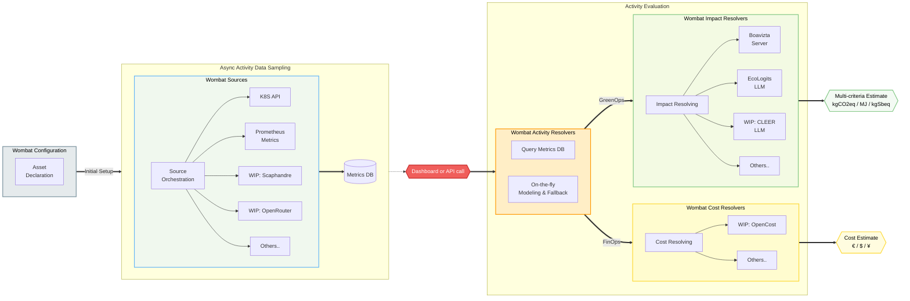

# Wombat Carbon Tracker 

[](https://github.com/illuin-tech/wombat/actions/workflows/maven-build.yml)
[](https://hub.docker.com/r/illuin/wombat)
[](https://codecov.io/gh/illuin-tech/wombat-core)


Wombat is a multi-criteria environmental impact tracker for digital and AI services.

Its goal is to streamline the use of astounding work being done by others on environmental footprint calculators, methodology and referential data (namely works from [Boavizta](https://boavizta.org/en), [SustainableAIGroup](https://reports.sustainableaigroup.com/CLEER-Tech-Report/), [Ecologits](https://ecologits.ai)..) and use it where it has the biggest impact:
* at the **_software design stage_**, so as to inform key solution sizing decisions
* after launch, at the **_operations stage_**, so as to inform decision makers on the evolution of their solution's impact

To do that, we focused on a few key ideas:
* a tool that is adaptable regarding **_data sources_**, to make it easier to aggregate quality data, but also offer fallback strategies when that data isn't readily available
* a tool that is **_easy to deploy_**, so as to be able to justify setting it up alongside a lone AI stack, just like it can aggregate data from dozens of different projects in a more centralized fashion
* a tool that **_doesn't reinvent the wheel_**, there are many people working on other challenging parts of the estimation process, so we built a modular system with integrations for calculation engines like Boavizta, Ecologits (and soon CLEER), we also expect to encounter situations where methodology has to be tweaked in one way or another: we built wombat with that in mind
* a tool that tries to **_contextualize ecological impact_** with financial and business metrics: these combined metrics can help paint a complete picture of how much your AI stack costs; _most often_ a large LLM that is costly to use also has a large environmental footprint

In short, Wombat is:
* a Java app (this repository) deployable as [a docker container](https://hub.docker.com/r/illuin/wombat) directly, or on K8S through a [pulumi resource or helm chart](https://github.com/illuin-tech/wombat-k8s)
  * the app exposes a [dashboard](#dashboard) and [HTTP endpoints](#http-api)
* a Java SDK, [wombat-core](https://github.com/illuin-tech/wombat-core), for creating custom modules or directly integrating its core features into other systems

## Dashboard

The Wombat dashboard is accessible at the root path and after running for some time should look something like this:


## HTTP API

Wombat exposes HTTP endpoints, it aims at the same feature coverage in both UI and API so as to enable integration with other tools.

Currently, there are two API hubs:
* `api/impact` is the equivalent of the dashboard but in JSON form, it makes it possible to query active environments and get impact estimations for their services
* `api/simulation` is for getting estimates over entirely manufactured asset descriptions and service activity summary

*Documentation is coming soon™*

## How It Works

Wombat works by doing a few things:
1. **Configuration**: the user provides a set of configurations that will define the scope of the activity to be measured: either through actual data-source connectors (e.g. querying a K8S cluster's metrics API) or through declarative hypothesis
2. **Activity sourcing**: for each of these configurations, if needed, wombat will orchestrate the activation of sources and compile activity metrics into a database
3. **Activity resolving**: when an estimation is requested, it will gather observed and modeled activity metrics for a given time period
4. **Evaluation**: activity data is then submitted to a modular evaluation engine, which will return a standardized multi-criteria impact estimate

_The big picture:_



Each compartment of the engine is modular so as to be extensible. So you can add new ways to:

* source activity data: either for other OSS projects (for which we'll work on expanding in the [core modules](https://github.com/illuin-tech/wombat-core#core-modules) or your own custom-made platform
* estimate activity: this can be done for simulation purposes but also if you need to source data without persisting it into wombat (e.g. this can be a custom DB or API call)
* estimate environmental (or cost) impact: we'll try to have all the main OSS calculators in the core modules, but you can also have your own custom one

_In more details:_



## Documentation

*Documentation is coming soon™*

## How to run

Here is a sample docker-compose local setup for:

* Wombat app
* local BoaviztAPI & Ecologits instances
* a temporary sqlite + periodic S3 backup *(this is a demo ; on a local setup you would rather swap that out for an sqlite db file written to a docker volume and do away with the backup)*


```yaml
services:
  wombat:
    image: illuin/wombat:latest
    ports:
      - "8080:8080"
    volumes:
      - ./application.yaml:/deployments/config/application.yaml:ro
      - ./monitored-environments.yaml:/deployments/monitored/monitored-environments.yaml:ro
      - ./k8s:/deployments/monitored/k8s:ro

  boavizta:
    image: ghcr.io/boavizta/boaviztapi:2.4.1

  ecologits:
    image: ghcr.io/mlco2/ecologits-api:0.0.2

  seaweedfs:
    image: chrislusf/seaweedfs
    command: mini -dir=/data
    ports:
      - "8333:8333"   # S3 endpoint
      - "8888:8888"   # Filer UI
      - "9333:9333"   # Master
      - "23646:23646" # Admin UI
    environment:
      AWS_ACCESS_KEY_ID: admin
      AWS_SECRET_ACCESS_KEY: secret
      S3_BUCKET: wombat-bucket
    volumes:
      - seaweedfs-data:/data

volumes:
  seaweedfs-data:
```

With the following `application.yaml` file:

```yaml
quarkus:
  datasource:
    jdbc:
      url: "jdbc:sqlite:/tmp/local.db" # if you disable the backup below, you can use a volume or local file instead, and remove seaweedfs from your compose file

connector:
  boavizta:
    uri: "http://boavizta:5000/v1/"
  ecologits:
    uri: "http://ecologits:80/"

backup:
  enabled: true
  cron: "0 */10 * * * ?"  # every 10 minutes
  cleanup:
    cron: "0 */10 * * * ?"  # every 10 minutes
    retain-last: 10
  s3:
    key-prefix: sqlite/local/
    endpoint: http://seaweedfs:8333
    region: "eu-west-1"
    bucket: wombat-bucket
    access-key: admin
    secret-key: secret
```

And the following `monitored-environments.yaml` file:

```yaml
environments:
  production:
    id: production
    assets:
      # This type works by querying the kubernetes metrics API and gathering CPU/RAM load factors for each deployed container. 
      - type: tech.illuin.wombat-module.kubernetes-api
        id: prod-cluster
        environment-id: production
        name: Production Cluster
        namespace: my-project-namespace
        config-path: /deployments/monitored/k8s/my-kube.config
        profile:
          provider: aws
          instance-type: c5.xlarge
          location: FRA
          lifespan: 43800
      # This type works with a request yearly estimate and will prorate it dynamically. 
      # This is the bare minimum available in some situations.
      - type: tech.illuin.wombat-module.llm-static
        id: prod-llm
        environment-id: production
        name: LLM Services
        profile:
          models:
            - provider: mistralai
              model: mistral-large-latest
              location: FRA
              request-profile:
                output-token-count: 500
                request-per-year: 500000
            - provider: openai
              model: mistral-large-latest
              location: SWE
              request-profile:
                output-token-count: 150
                request-per-year: 8000000
```

And a valid kubeconfig in `k8s/`, in the configuration above we've named it `my-kube.config`.

### Running in dev mode

If you want to run it in dev mode:

```bash
./mvnw quarkus:dev
```

This will require you to have a functional Java 25+ JDK installed on your machine.

### Dashboard frontend

The dashboard uses Pebble for server-rendered layouts, authentication, metric formatting
and asset details. Interactive controls are precompiled **Vue 3 single-file components**
under [src/main/frontend](src/main/frontend). This is not a SPA: filters keep the existing
query parameters and reload the page; no Vue Router or new API is required.

Install **Node 24.15+ (LTS)** and **npm 11+** as well as JDK 25. Maven runs `npm ci` and
the Vite production build during `generate-resources`, and frontend tests during `test`
(unless `-DskipTests` is set). The lockfile pins frontend dependencies.

```sh
npm ci
npm test
npm run build
./mvnw quarkus:dev
```

For frontend edits during an existing dev session, run `npm run dev` in another terminal.
It watches and rebuilds the bundle; reload the browser after rebuilding. Vite writes
only to `target/classes/META-INF/resources/public/ui`, served locally at `/public/ui/app.js`.
CI installs Node before the Maven build. Use **Vue - Official** in VS Code for `.vue` files.

Pebble partials expose `data-vue-*` mount points with escaped metadata, inert `<template>`
content and script-safe chart JSON. [main.js](src/main/frontend/main.js) reads these inputs
and mounts the relevant Vue components. Vue alone defines interactive markup: filter controls,
modal shells, charts, service details and the theme toggle. Filter options are carried as
native `<select multiple>` data inside an inert template, not as a second set of controls.
Pebble retains page composition, asset-detail content and formatted service metric cells.
Shared date/query/chart utilities live in `frontend/utils`. Static details and
formatted metric cells are moved as existing DOM nodes, never compiled as Vue templates or
inserted through `v-html`. Keep server values HTML-escaped, including inside embedded blocks,
and keep JSON payloads serialized through `TemplateRenderer.scriptSafeJson`.
Vue templates are compiled by Vite, so the browser does **not** need `unsafe-eval`.
The early theme bootstrap remains a small local script to avoid a theme flash.

Components own and dispose their chart/picker instances and listeners. Normal navigation
unmounts islands; BFCache navigation preserves them. Existing Chart.js and easepick assets
remain Maven-vendored. Dates retain UTC whole-day/exclusive-end semantics, the native date
fallback and maximum-range clamping. Empty service selection still means all services.

To export browser fixtures from rendering tests, add `-Dtest.preview.directory=target/ui-preview`.
The full Java build requires a core-module artifact containing the `llm_google` package.

### Optional Google Workspace authentication

OIDC is disabled by default. To protect the dashboard and API, set
`QUARKUS_OIDC_TENANT_ENABLED=true`, `QUARKUS_OIDC_CLIENT_ID` and
`QUARKUS_OIDC_CREDENTIALS_SECRET` in the deployment environment. Register the deployed
application's callback URI with Google; use HTTPS in production.
The Google provider preset uses a hybrid flow for browser sessions and bearer API clients.
The required `hd` token claim restricts accounts to `illuin.tech`; override
`quarkus.oidc.token.required-claims.hd` for another Workspace domain.
Do not store client secrets in tracked configuration.

The shared Pebble header shows the authenticated user's email and a sign-out link.
`/logout` clears only the local Wombat session, not the Google account's browser session.
The next login requests Google's account chooser. Logout, health/metrics and local
UI resources stay publicly accessible; other endpoints require authentication when enabled.

### Custom Extensions

Wombat allows user to provide custom modules built with `wombat-core` (see [repository](https://github.com/illuin-tech/wombat-core)) to extend its functionality.

Custom modules (e.g. `wombat-simulator`) are loaded **_at startup_** from every JAR found in `module.extension.path`
(defaults to `extensions`, relative to the working directory). Override it with `-Dmodule.extension.path=...` or `MODULE_EXTENSION_PATH=...`.

When starting up the app with a custom extension, you should see logs like these:

```
2026-10-01 16:42:56,837 INFO  [tech.illuin.wombat.module.extension.DynamicExtensionLoader] (Quarkus Main Thread) Loading extensions from /path/to/extensions (1 jar(s))
2026-10-01 16:42:56,839 INFO  [tech.illuin.wombat.module.extension.DynamicExtensionLoader] (Quarkus Main Thread) Discovered extension module tech.illuin.wombat.module.simulator.k8s.KubernetesSimulatorModule for asset-type tech.illuin.wombat-simulator.kubernetes
2026-10-01 16:42:56,839 INFO  [tech.illuin.wombat.module.extension.DynamicExtensionLoader] (Quarkus Main Thread) Discovered extension module tech.illuin.wombat.module.simulator.llm.LLMSimulatorModule for asset-type tech.illuin.wombat-simulator.llm
2026-10-01 16:42:56,839 INFO  [tech.illuin.wombat.module.WombatModuleConfig] (Quarkus Main Thread) Wiring 6 wombat module(s): [KubernetesSimulatedModule, LLMSimulatedModule, LLMStaticModule, KubernetesAPIModule, KubernetesSimulatorModule, LLMSimulatorModule]
```

## How to build

Building the project requires a Java 25+ JDK. You can use the Maven wrapper (`./mvnw`) to compile, test, and package the application:

Compile it:

```bash
./mvnw compile
```

Run all tests:

```bash
./mvnw test
```

Package it (as a .jar in `target/`):

```bash
./mvnw package
```

To package it without running tests, append `-DskipTests`:

```bash
./mvnw package -DskipTests
```

## License

This project is licensed under the GNU Affero General Public License v3.0 (AGPL-3.0) ; see the [LICENSE](LICENSE) file for details.

Copyright (c) 2026 Illuin Technology.
